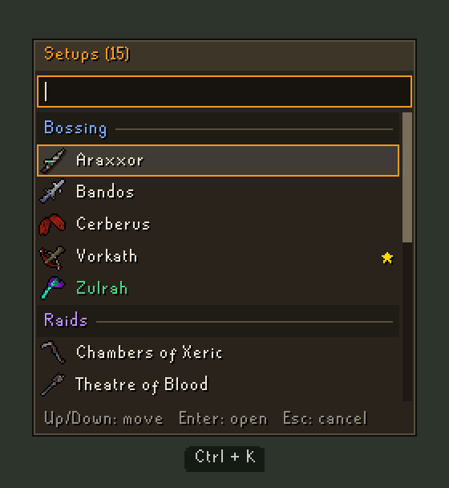
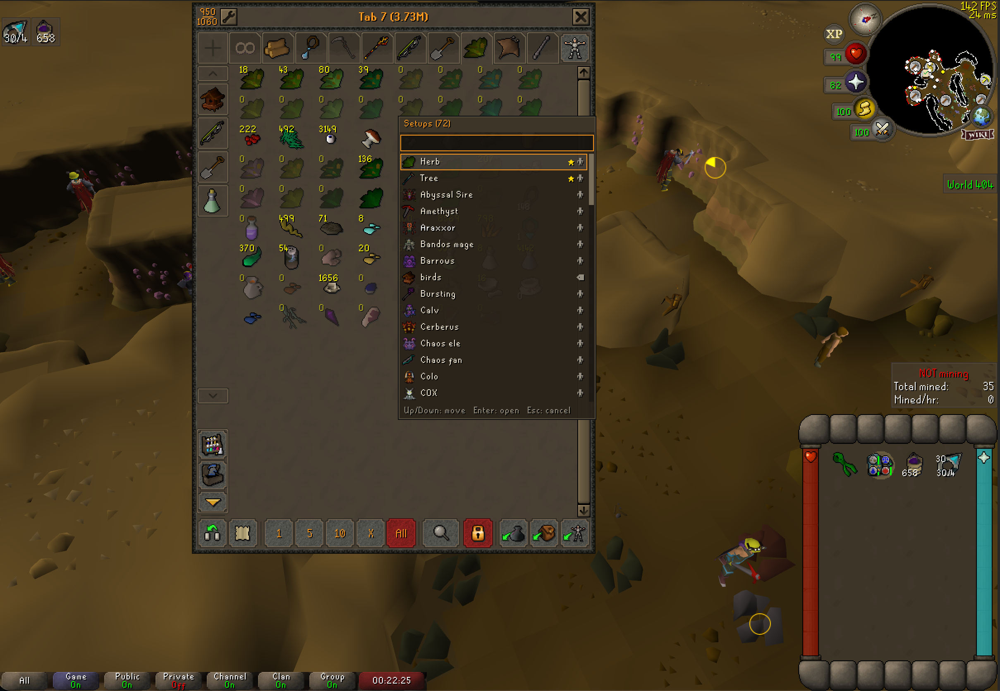
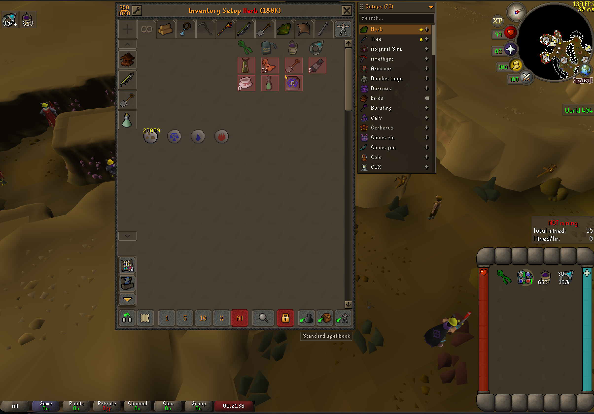
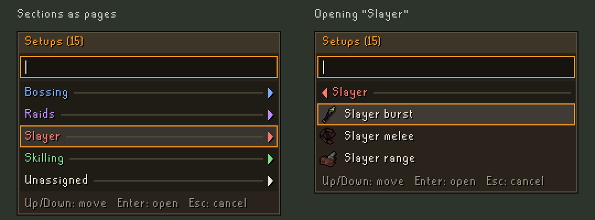
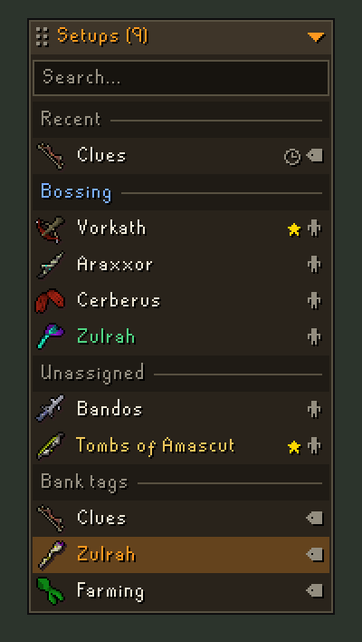
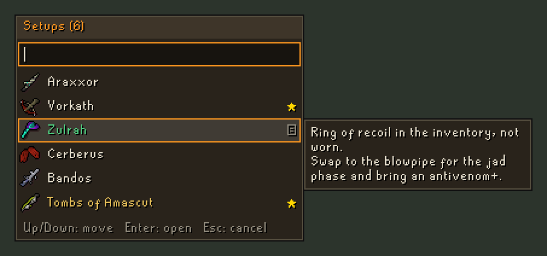
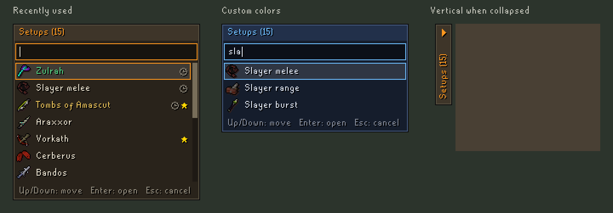

# Inventory Setups Picker

A companion to the [Inventory Setups](https://github.com/dillydill123/inventory-setups) plugin that lets you open
your setups from inside the game instead of the side panel. It can also list your Bank Tag tabs and open them with
their layouts.

- **Hotkey popup**: press Cmd+K / Ctrl+K anywhere, type a few letters, press Enter.
- **List beside the bank**: click a setup to open it, drag the list wherever you like.
- **Highlighted differences**: outlines bank items you still need to withdraw or equip.
- **Sections, bank tags, notes, recent setups and spellbook reminders**, all optional.
- **Matches your resource pack** by drawing with the game's own interface sprites.

## Hotkey popup

Press **Cmd+K** (Mac) or **Ctrl+K** (Windows/Linux) anywhere in game to open a list of all your setups. The key can
be changed, and the modifier turned off, in the settings. If you use [Platform Keys](https://github.com/akump/platform-keys),
the modifier follows its key profile so the shortcut matches its bank search.

| Key | Action |
| --- | --- |
| Type | Filter by name |
| `Up` / `Down`, `Tab` / `Shift+Tab` | Move the selection |
| `Page Up` / `Page Down` | Move a page at a time |
| `Enter` | Open the selected setup, or close it if it's already open |
| `Left` / `Right`, `Home` / `End` | Move the cursor in the search text |
| `Backspace` / `Delete` | Delete before / after the cursor |
| `Ctrl+A` / `Cmd+A` | Select the search text |
| `Esc`, the hotkey again, or clicking elsewhere | Cancel |

While the popup is open, keys go to it rather than the chatbox, even ones Key Remapping or Platform Keys would
normally change.

If a setup is already open, the popup starts with it selected, so hotkey + `Enter` closes it. Turn off **Start on
open setup** to always start at the top.

## Beside the bank

While the bank is open, the same list sits next to it. Click a setup to open it (or the open one to close it), click
the search box to filter, scroll with the mouse wheel, and click the title bar to collapse it.

- **Moving it**: drag the title bar (by the six-dot grip) anywhere. It stays where you leave it relative to the
  bank. Right-click the title bar, or change **Bank side**, to put it back.
- **Collapsing**: collapsed, the list shrinks to its title bar, or with **Vertical when collapsed** to a narrow
  upright tab against the bank.
- **Small clients**: set **Max rows** to stop the list running down over the inventory.

## Sections

If you sort your setups into sections in Inventory Setups, both lists group them the same way, in the side panel's
order, with everything else under "Unassigned". A setup in several sections is listed under each, and typing a
section's name lists all of its setups. Turn off **Group by section** for one flat list.

With **Sections as pages**, the lists show just the sections. Open one (click, or `Enter`) to see its setups; go
back by clicking its name or pressing `Left` / `Backspace` in an empty search box. Searching on a section's page
searches that section; searching the list of sections searches everything.

## Bank tags

The **List** setting chooses what to show: your Inventory Setups (default), your tag tabs from RuneLite's Bank Tags
plugin, or both. Picking a bank tag opens it with its layout, just like clicking its tab.

With both listed, each row is marked as a setup (a little person) or a bank tag (a tag). Bank tags go under their
own "Bank tags" heading when the list is grouped by section; if none of your sections has a setup in it, your setups
go under an "Inventory Setups" heading so the two stay apart. Turn off **Group by section** to mix them in one list.
Tags opened from their tabs count as recently used.

## Notes

With **Show notes**, setups that have notes in Inventory Setups are marked with a small page, and the notes of the
selected or hovered setup are shown in a box beside the list. Long notes are cut off after eight lines.

## Spellbook

With **Show spellbook**, a line under the bank says which spellbook the open setup is for, such as "Lunar
spellbook", or "Needs Lunar spellbook" in red when you're on a different one.

## Highlighted differences

For a setup with **Highlight differences** turned on in Inventory Setups, the bank items its side panel highlights
are outlined in the bank too, in the setup's highlight color, so you can see what's left to withdraw or equip. They
follow the setup's own settings:

- **Unordered highlighting** off: an item counts as missing unless it's in the same inventory slot as in the setup.
  On: it can be anywhere in your inventory. Each slot counts, so with four sharks in the setup and two in your
  inventory the sharks stay outlined.
- **Fuzzy** items match whatever their charges or variant, so a ring of dueling(3) does for a ring of dueling(8).
- **Stack compare** outlines an item when you have more or fewer than the setup, as it's set to.

Equipment is compared slot by slot. Runes in the setup's rune pouch can be in any slot of yours; with no rune pouch
in your inventory, all of them are outlined. Only setups that filter the bank are highlighted. Turn off **Highlight
differences** in this plugin's settings to hide the outlines for every setup, or turn on **Override difference
color** to use one color for all of them.

## Sorting and search

Setups show the icon, color and favorite star you gave them in Inventory Setups. With **Boss icons**, setups named
after a boss show its hiscores icon instead.

- **Sort alphabetically** (on): sort by name, or keep the side panel's order.
- **Favorites first** (on): list favorites before the rest.
- **Recently used** (off): list up to 10 of your most recently opened setups at the top, marked with a clock.
  Setups opened from the side panel count too.
- **Fuzzy search** (on): when nothing matches as typed, also match typos (`vorkahh`) and skipped letters (`vkdh`).

## Colors and resource packs

The **Colors** section of the settings sets the background, title bar, border, accent and text colors. Right-click
a setting's name and choose "Reset" to restore it.

To match a resource pack exactly, turn on **Match resource pack**. The lists and notes are then drawn with the
game's own interface sprites (the bank's steel frame and background, stone input boxes and scrollbar), so whatever
the [Resource Packs](https://runelite.net/plugin-hub/show/resource-packs) plugin or Interface Styles do to the bank,
they do to the lists too. Only the accent and text colors are used in this mode.

## Settings

| Setting | Default | What it does |
| --- | --- | --- |
| List | Inventory Setups | List Inventory Setups, Bank Tags, or both. |
| Show tips | On | Mention once in the chatbox an option that would do more with a setup you've opened. See [Tips](#tips). |

**Hotkey popup**

| Setting | Default | What it does |
| --- | --- | --- |
| Open hotkey | K | The key that opens the popup. |
| Require Ctrl/Cmd | On | Require Cmd (Mac) or Ctrl (Windows/Linux) with the hotkey. Follows Platform Keys when it's on. |
| Start on open setup | On | Open the popup with the open setup selected. |
| Popup rows | 10 | Rows the popup shows before scrolling. |

**Display**

| Setting | Default | What it does |
| --- | --- | --- |
| Show icons | On | Show each setup's icon. |
| Boss icons | Off | Show a boss's hiscores icon for setups named after it, e.g. "Vorkath (dhcb)", "kq", "CoX CM", "zuk", "Sara gwd". |
| Show notes | Off | Mark setups with notes and show the notes of the selected or hovered one. |

**Order and search**

| Setting | Default | What it does |
| --- | --- | --- |
| Sort alphabetically | On | Sort by name instead of the side panel's order. |
| Favorites first | On | List favorites before the rest. |
| Recently used | 0 | How many recently opened setups to list at the top. 0 turns it off. |
| Group by section | On | Group setups under their Inventory Setups sections. |
| Sections as pages | Off | List just the sections, and open one to see its setups. |
| Fuzzy search | On | Allow typos and skipped letters when nothing matches as typed. |

**In bank**

| Setting | Default | What it does |
| --- | --- | --- |
| Highlight differences | On | Outline bank items Inventory Setups highlights for the open setup. Only for setups with Highlight differences on. |
| Show spellbook | Off | Show which spellbook the open setup needs under the bank. |

**Beside the bank**

| Setting | Default | What it does |
| --- | --- | --- |
| Show beside bank | On | Show the list next to the bank. |
| Bank side | Left | Which side of the bank the list sits on. Also puts a dragged list back. |
| Width | 160 | Width of the list beside the bank, in pixels. |
| Max rows | 0 | Most rows beside the bank before scrolling. 0 means as many as fit. |
| Vertical when collapsed | Off | Collapse to an upright tab instead of a title bar (when beside the bank). |

**Colors**

| Setting | Default | What it does |
| --- | --- | --- |
| Match resource pack | Off | Draw the lists with the game's interface sprites. |
| Background, Title bar, Border, Accent, Text | | Colors of both lists. |
| Override difference color, Difference | Off, red | One color for highlighted differences instead of each setup's own. |

## Tips

Several Inventory Setups options change what this plugin can do. When you open a setup that would get more out of
one, the plugin mentions it once in the chatbox:

- the setup doesn't filter the bank
- **Highlight differences** is off for the setup, so nothing is outlined in the bank
- the setup is for the Ancient, Lunar or Arceuus spellbook and **Show spellbook** is off
- the setup has notes and **Show notes** is off

At most one tip is shown per setup opened, and each only once per RuneLite profile. Turn off **Show tips** to have
none.

## Requirements

- [Inventory Setups](https://github.com/dillydill123/inventory-setups) installed and enabled to list setups.
- RuneLite's Bank Tags plugin enabled to list bank tags.

The picker only lists and opens what you already have; it doesn't store any setups or tags itself. After an update
that adds something, it mentions it once in the chatbox the next time you log in.

## Credits

Bank Tags support is based on Bank Tag Picker by **Ian-Fund**, a fork of this plugin. Thanks for that work.

## Development

`./gradlew runClient` starts RuneLite with the plugin loaded. `./gradlew test` also renders previews to
`build/preview.png`, `build/preview-mixed.png` (setups and bank tags together) and `build/preview-game.png` (drawn
with stand-ins for the game's sprites).
